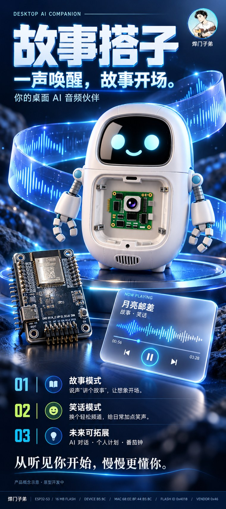
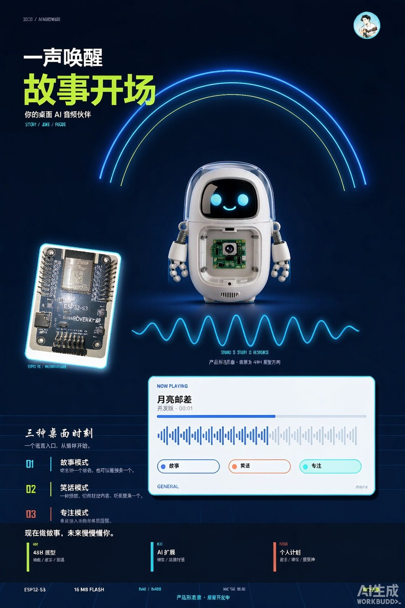
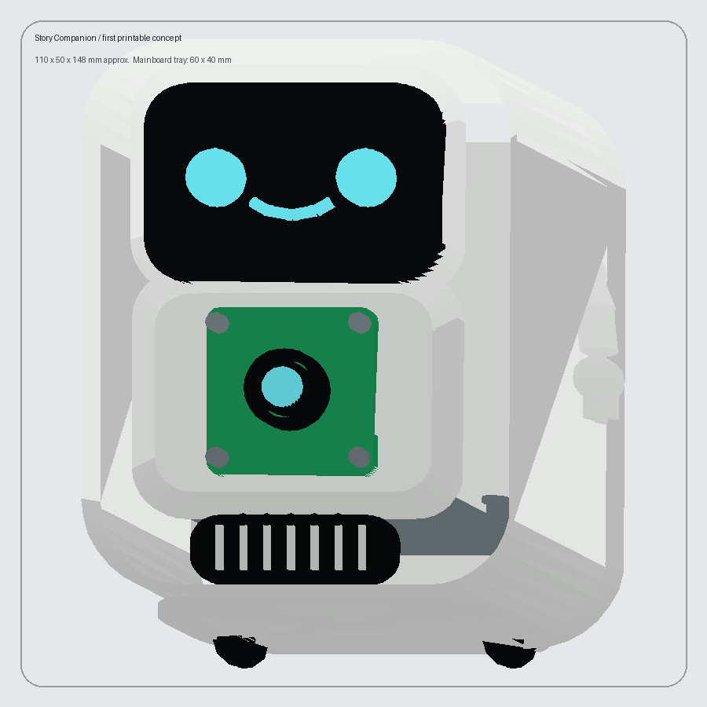
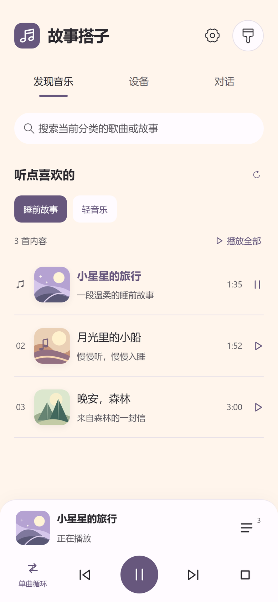
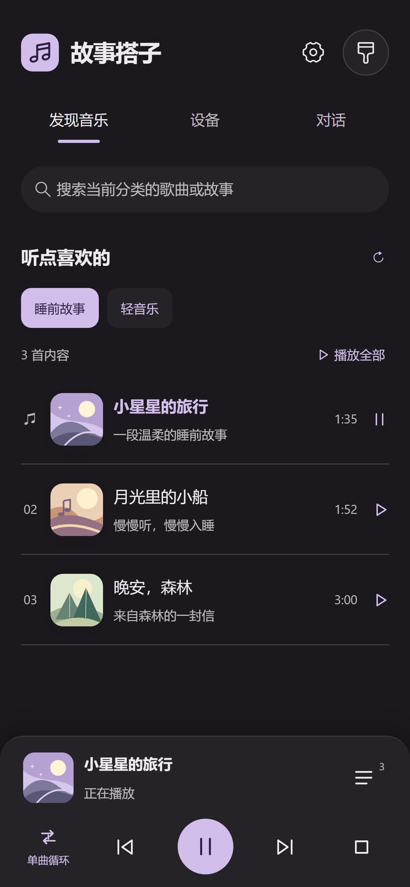
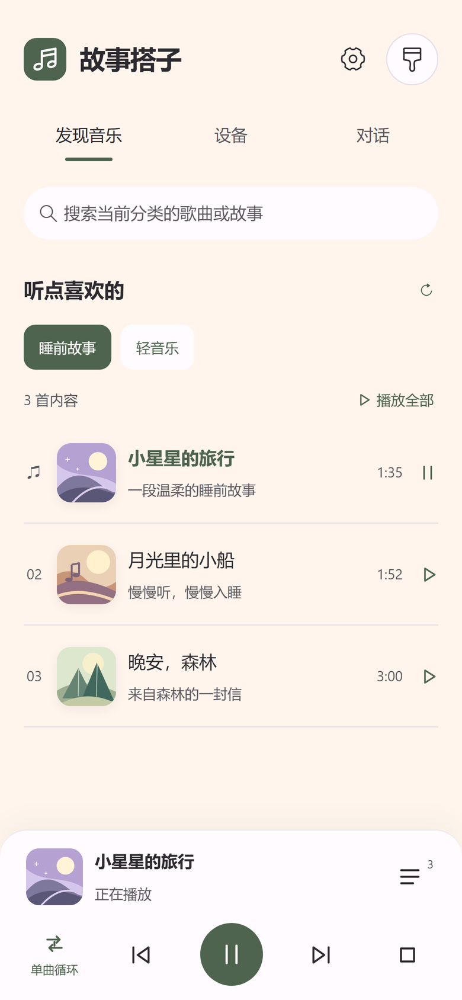
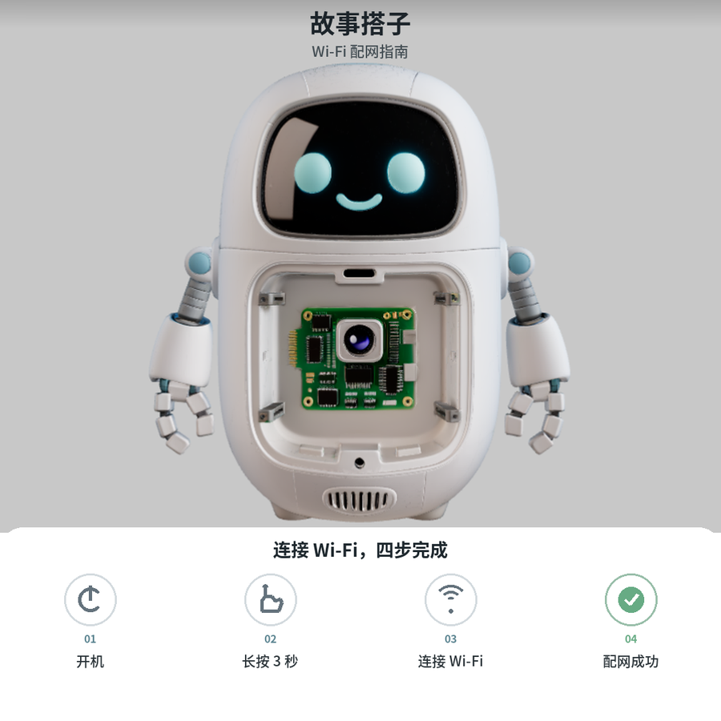
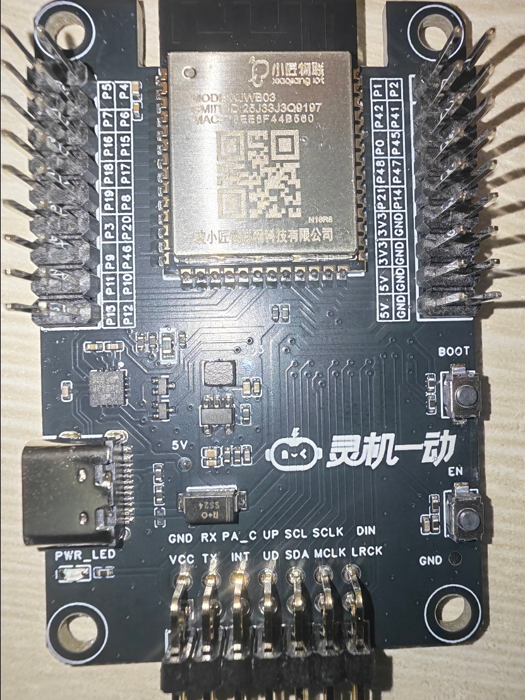
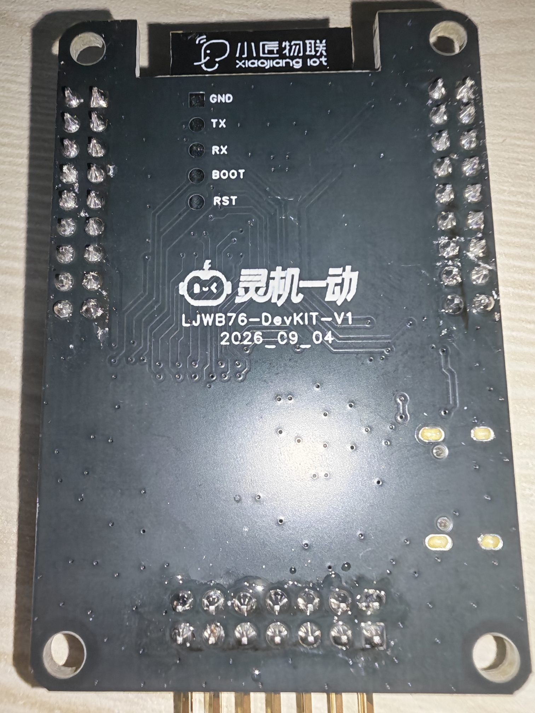

# 故事搭子

<p align="center">
  
</p>

**一声唤醒，故事开场。** 一台放在桌上的 AI 音频伙伴：说声「讲个故事」，它就开始讲；换个心情，也能讲个笑话、放首歌。圆润的白壳、黑色笑脸、胸前摄像头，短胳膊能挥。

本项目是 **灵机一动硬件黑客松（2026 宁波）** 参赛作品，队名 **焊门子弟**。

> 除第三方依赖外，本项目代码、界面设计与视觉资产版权归焊门子弟所有，保留所有权利。详见文末「版权与原创声明」。

- 硬件平台：灵机 XJWB03-DevKIT-V1（ESP32-S3）+ VB701N 音频模块
- 固件：ESP-IDF 5.4.1，跑在 `apps/main`
- 控制面板：Vue 3 + Vite + Vant 4 的 H5 插件，上传到灵机平台「04 控制面板」
- 云侧：灵机云平台产品 PID 11910，语音链路走云端 ASR / LLM / TTS

---

## 功能

| 功能 | 实现 | 状态 |
| --- | --- | --- |
| 故事模式 | 语音触发 → 云端智能体生成内容 → TTS → VB701N 播放 | 语音链路已打通 |
| 笑话模式 | 同上，换一套提示词与音色 | 语音链路已打通 |
| 专注模式 | 持续播放氛围音，面板控制启停 | 播放器链路支持 |
| 语音对话 | 板载麦克风 → 云端 ASR → 智能体 → TTS → VB701N 播放 | 听懂并回复过一次；连续对话稳定性仍在调 |
| 音乐播放 | 面板下发 `player/play|pause|resume|stop`，云端返回 PCM URL 播放 | 命令链路与状态回执通过，扬声器实际听感待确认 |
| 表情灯效 | WS2812 灯圈随语音状态变色 | 已实现 |
| 动作反馈 | 舵机转头 / 扭身，震动马达提示 | 驱动与动作已实现 |
| 控制面板 | 曲库浏览、播放控制、主题切换、3D 外观与打印演示 | 生产构建 + 25 项浏览器模拟通过，已上传平台 |
| 姿态识别 | `apps/main/pose` 内置 YOLO11n-pose 模型（ESP-DL） | 模型与代码在，摄像头未接入主流程 |
| 摄像头 | 转接板已画板接线 | 预留，用途未定 |

## 硬件清单

- 灵机 XJWB03-DevKIT-V1 主板（ESP32-S3）
- VB701N 音频模块（扬声器 / 麦克风）
- MPU6050 六轴姿态传感器
- 舵机（点头 / 扭身动作）
- 震动马达
- WS2812 灯圈
- 摄像头转接板 + 摄像头（预留）
- 3D 打印外壳（圆润白壳，模型见 `tools/robot_companion_design_v2.py`）

模块数据手册、主板图与转接板接线说明见仓库内 PDF 与 `接线说明.md`。

## 目录结构

```
starline/
├─ ljyd_xjwb03_agent_public_developer/   # 灵机 SDK + 本项目固件
│  ├─ apps/main/                          # ★ 本项目业务代码
│  │  ├─ voice/                           #   语音会话与开机音
│  │  ├─ cloud/                           #   云连接、MQTT 方法分发、Wi-Fi 配网（含 10 次失败回退 BLE）
│  │  ├─ agent/                           #   智能体应用层
│  │  ├─ peripheral/                      #   MPU6050 / 舵机 / 震动马达 / WS2812 / 摄像头 驱动
│  │  └─ pose/                            #   YOLO11n-pose 姿态识别（ESP-DL）
│  ├─ components/                         #   定制与第三方组件（esp-sr 语音识别、云端组件等）
│  ├─ doc/                                #   SDK 说明文档
│  └─ qumios-dev/                         #   灵机平台开发工具
├─ control-panel/                         # ★ H5 控制面板（详见下方专节）
├─ tools/                                 # 外壳 3D 设计与海报渲染脚本（Python / Three.js）
├─ docs/images/                           # README 用预览图（海报、概念图、面板截图等，已压缩）
├─ 硬件开发说明书/                         # 板级硬件、模块原理、坑点与烧录说明
└─ DEV_STATE.md                           # 开发过程与验证状态记录
```

`output/`、`outputs/`、`tmp/` 为本地生成产物与缓存，未纳入版本管理；`esp-idf/`、烧录包与编译产物同样不提交。

## 编译与运行

### 固件

```bash
# 需要 ESP-IDF 5.4.1（官方框架未随仓库提交，请自行安装）
cd ljyd_xjwb03_agent_public_developer
./install.bat            # 首次：安装 IDF 与工具链
./export.bat             # 激活环境（PowerShell 用 export.ps1）
cd apps
idf.py build             # 产物 apps/build/vb701n.bin
idf.py -p COM5 flash monitor
```

设备启动后通过 BLE 配网，联网后自动注册 DID 并连接 MQTT；`voice status` 可查云连接状态。

---

## 控制面板（control-panel/）

面向终端用户的 H5 面板，由灵机小程序 / App 承载，上传到平台后绑定设备即可使用。目标是打磨成一个「能日常用」的播放器，而不是调试页。

### 技术栈

| 层 | 选型 |
| --- | --- |
| 框架 | Vue 3.5（`<script setup>`）+ TypeScript 5.3 |
| 构建 | Vite 5，产物为单页 H5 插件 ZIP |
| 组件库 | Vant 4.10 + 灵机 `xjiang-ui`（vendor 内置） |
| 设备通信 | 灵机 `xjiang-sdk`（vendor 内置），MQTT 方法下发与事件回执 |
| 样式 | Tailwind 3 + SCSS |
| 配色 | `@material/material-color-utilities` 的 Material HCT 语义色阶 |

### 功能

- **曲库**：打开已绑定设备后自动载入分类与曲目，支持当前分类内搜索；切分类不打断当前队列
- **播放控制**：播放 / 暂停 / 继续 / 停止、上一首 / 下一首，底部固定操作条
- **队列**：完整队列可见，失败保留队列、不重复提交
- **播放模式**：顺序 / 列表循环 / 单曲循环 / 随机，模式与皮肤记忆
- **设备音量**：独立音量控制；未知在线状态允许尝试，明确离线或身份不匹配时禁写
- **对话记录**：保留语音会话结果，与播放状态区分
- **设备信息**：PID / DID / 版本折叠到设置，不占主界面
- **3D 外观与打印**：设备页入口，内嵌自包含 Three.js 演示，附 3MF 下载，不依赖设备在线、不需重新烧录
- **三套主题**：暖雾紫 / 夜幕 / 苔绿，按 Material HCT 角色生成，不逐按钮挑色

### 目录

```
control-panel/
├─ src/
│  ├─ App.vue            # 主界面与页面骨架
│  ├─ player.ts          # 播放器状态机、队列与模式
│  ├─ api.ts             # 设备方法调用封装
│  ├─ bridge.ts          # 灵机宿主桥接（设备身份、授权）
│  ├─ themes.json        # 三套主题色（脚本生成）
│  ├─ components/        # CoverArt（矢量封面）、PlayerIcon
│  └─ utils/
├─ scripts/
│  ├─ generate-themes.mjs  # 改基色后重新生成主题
│  ├─ check-player.mjs     # 25 项浏览器模拟检查
│  └─ package.ps1          # 打包上传用 ZIP
└─ vendor/                 # xjiang-sdk、xjiang-ui
```

### 开发与发布

```bash
cd control-panel
npm install
npm run dev              # http://127.0.0.1:18763
npm run check:browser    # 交互 / 布局 / 身份等 25 项检查
npm run build            # 生产构建
npm run package          # 打包成平台可上传的 ZIP
```

浏览器直接打开只会显示「等待连接」，需要宿主提供设备身份与访问授权。

上传流程：灵机平台 → 产品 **PID 11910** → 04 控制面板 → 上传控制面板 → 填比已发布版本更大的插件版本号 → 发布（本地打包不等于已发布）。注意 11913 是另一个产品，不能混用。

### 已验证范围

- Vite 生产构建通过，ZIP 结构与体积校验通过
- 25 项浏览器模拟（交互、三主题布局、身份校验）通过
- 三套主题 15 组文字 / 操作色对比度最低 5.99:1（基础对比度检查，非完整 WCAG 评估）
- 手机实机加载第一版面板并取得 PID11910 / DID100000817，设备听懂并回复过一次
- 未验收：三主题截图为虚构曲目的测试数据，不能作为云平台或扬声器验收证据；真机歌曲出声与自动循环仍待验证

---

## 视觉与设计产物

以下是设计稿与渲染预览（已压缩，原图在本地 `outputs/`，体积原因未提交）。这些是**概念与原型产物**，不等同于已验收的产品形态。

### 海报（800 × 1800 mm 竖版）

<p align="center">
  
</p>

按展架尺寸设计的主视觉：作品名 + slogan「一声唤醒，故事开场」+ 三种模式说明 + 无人机（板卡、播放器界面）组合构图。原图 836×1881 px，用于 800×1800 mm 输出约 26.5 PPI，属概念预览精度，未做高精度印刷制版。

### 产品概念图

<p align="center">
  
</p>

三种桌面时刻的产品定义：**故事模式**（一句口令，从剧情开头）、**笑话模式**（换个频道，给日常加点笑声）、**专注模式**（持续播放氛围音）。下方为规划中的扩展方向：AI 对话、个人计划（待办 / 闹钟 / 番茄钟）。

### 3D 外观模型

<p align="center">
  
</p>

由 `tools/robot_companion_design_v2.py` 程序化生成，可在面板「3D 外观与打印」中旋转查看并下载 3MF。**未做切片试装与打印验证**，内部结构为示意。

### 控制面板三套主题

| 暖雾紫 | 夜幕 | 苔绿 |
| --- | --- | --- |
|  |  |  |

390px CSS 宽度 × 3 倍像素比输出。**曲目为虚构测试数据**，仅用于界面预览，不是云平台或扬声器验收证据。

### 配网引导图

<p align="center">
  
</p>

设备首次配网的四步引导示意。实际流程为 BLE 配网，连续 10 次 Wi-Fi 失败后自动清理旧配置并重启回 BLE。

### 硬件实拍

| 主板 | 主板背面 |
| --- | --- |
|  |  |

灵机 XJWB03-DevKIT-V1 实拍，模块手册与原理图见仓库内 PDF。


- 连续语音对话稳定性仍在调试，Agora 链路曾出现约 8 秒断开后自动恢复。
- 扬声器实际音量与听感未做客观验证；VB701N 未声明物理 DRAIN，播放回执依赖已接受的渲染帧写入。
- GPIO38 流控在驱动中为输入下拉，板卡文档标为输出，方向与极性尚未与原理图核对。
- 摄像头未接入；姿态识别模型在仓库内但未进入业务流程。
- 外壳 3MF 为外观预览模型，未做切片试装与打印验证，内部结构仍为示意。
- 主板完整原理图、BOM 未提供，GPIO 表来源为固件声明，不等同物理走线合同。

## 文档索引

| 文档 | 内容 |
| --- | --- |
| `DEV_STATE.md` | 开发过程、验证结论与当前状态（最详细） |
| `硬件开发说明书/` | 板级硬件原理、模块原理、开发路线、坑点、本地烧录 |
| `control-panel/README.md` | 控制面板使用、上传与设计说明（比本文件更细） |
| `接线说明.md` | 摄像头转接板接线与方向 |
| `灵机一动市场调研_2026-10-26.md` | 赛前市场与竞品调研 |
| `Anker黑客松与跨平台用户痛点调研_2026-10-27.md` | 用户痛点调研 |

## 说明

仓库为黑客松提交版本，保留了完整的灵机 SDK 应用层与组件，便于评委复现构建；体积较大的官方 ESP-IDF 框架、固件烧录包与生成产物未提交。

---

## 版权与原创声明

**作品「故事搭子」及其控制面板前端设计（`control-panel/`）由焊门子弟原创，保留所有权利（All Rights Reserved）。**

具体包括但不限于：

- **界面设计**：页面结构、信息层级、字号与间距体系（页头 22px / 分组 17px / 曲目 15px / 辅助 12px）、44px 最小触控区规范
- **视觉资产**：暖雾紫 / 夜幕 / 苔绿三套配色方案与 Material HCT 色阶取色逻辑、`CoverArt.vue` 的矢量封面生成规则、`PlayerIcon.vue` 图标
- **交互逻辑**：播放器状态机与队列规则（失败保留队列不重复提交、自然结束才自动切歌）、切分类不打断队列、离线禁写音量等行为约定
- **文案与命名**：作品名「故事搭子」、队名「焊门子弟」、界面文案与主题命名
- **外壳设计**：`tools/robot_companion_design_v2.py` 生成的 3D 外观模型

### 使用限制

本仓库公开仅为**黑客松作品提交与评审查阅**，不构成任何形式的开源授权：

- 允许：评审方为验收目的阅读代码、按本文档复现构建、在本地运行与截图
- 不允许：整站或大段复制本项目的界面设计、配色方案、交互实现用于其他参赛作品、商业产品或公开发布
- 不允许：去除或篡改署名后二次发布，将本项目代码或设计作为自己的作品提交
- 引用第三方依赖（Vant、Vue、Vite、Material Color Utilities、灵机 xjiang-sdk / xjiang-ui、ESP-IDF、ESP-SR）时，请遵循各项目自身的许可协议

### 已采取的技术措施

- 生产构建关闭 sourcemap（`build.sourcemap: false`），产物中不含原始源码结构
- 构建时移除 `console` / `debugger`（`esbuild.drop`），避免发布包输出临时授权信息与调试细节
- 控制面板不内置产品密钥；设备身份与访问授权由灵机宿主下发，面板不保存凭据
- 面板仅在宿主提供有效设备身份时可用，浏览器直接打开无法获得设备数据

### 侵权处理

如发现抄袭、洗稿或未署名转载，可通过仓库 Issue 或 GitHub 联系作者 `FreeCodeCampXYG`。仓库未添加开源许可证文件，即默认不授予复制、修改、分发权利。

