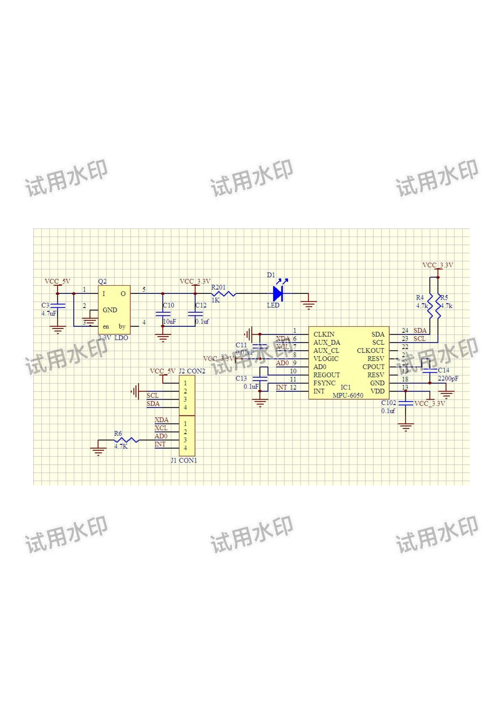
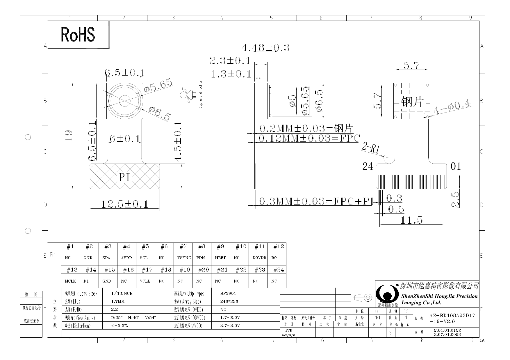
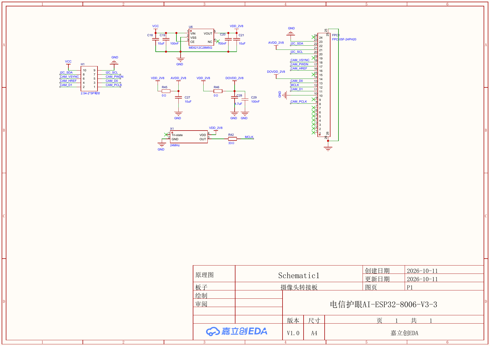
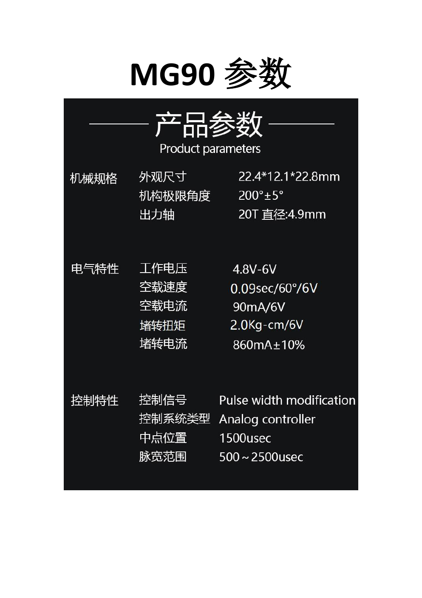
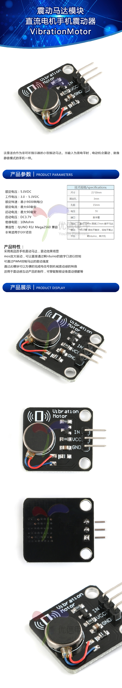
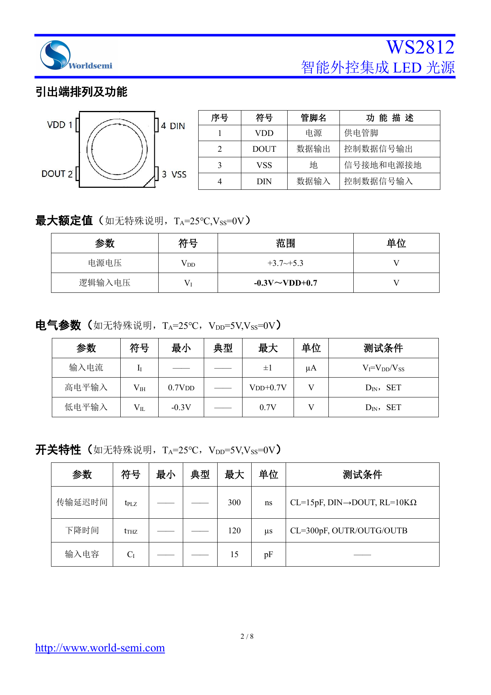
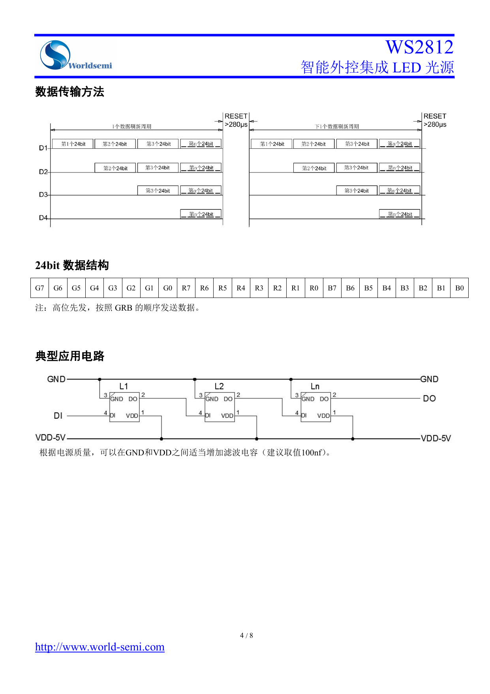

# 模块原理与信号链路

## 音频模块：数字控制链路与声音链路分开看

SDK/手册把组合方案写成 ESP32-S3 主控板加 LJX40 音频模块，VB701N 通过 UART 与应用交换音频/控制数据；手册描述格式为 Opus、16 kHz、单声道、20 ms。当前代码配置 UART1：GPIO40 TX、GPIO39 RX、GPIO38 flow control，波特率 2 MHz；日志/CLI 走 UART0 GPIO43/44、115200 baud。

麦克风和扬声器属于音频模块侧的声学端点，不要把“数字 UART 到 VB701N”误读成“扬声器线接 UART”。所给资料没有 LJX40 完整原理图，音频芯片到麦克风/功放的内部拓扑保持 `待确认`。

## MPU6050 模块：板载稳压与 I2C

模块图上主接口包含 VCC、GND、SCL、SDA；图纸显示 5 V 输入经 3.3 V LDO 给 MPU-6050，SDA/SCL 通过 4.7 kΩ 上拉到 3.3 V，AD0 由电阻拉低。该图是模块原理图，不是 ESP32 主板原理图。

当前 BSP 选择 I2C0、SDA GPIO8、SCL GPIO9、地址低位（`0x68`）。但 `main.c` 中 MPU6050 的初始化调用目前被注释，所以“驱动存在”不等于“当前固件上电会读传感器”。

供应方《新版本兼容说明》声称新旧模块只差 WHO_AM_I ID，并建议绕过 ID 校验；文件未给出新芯片完整料号、寄存器差异或测试条件。标准 MPU6050 的官方寄存器图把 WHO_AM_I 默认值列为 `0x68`。遇到读数异常应先记录模块版本、原始 ID、I2C 地址和原始寄存器读回，再查器件来源；不要先删身份校验。

## 摄像头：BF3901 模组、转接板和 1-bit SPI 采集

模块规格图标明芯片 BF3901、24-pin FPC、AVDD 2.7-3.0 V、DOVDD 1.7-3.0 V，并列出 SDA/SCL、VSYNC、PWDN、HREF、D0/D1、MCLK 等信号。

2026-10-11 的转接板原理图显示 ME6212C28M5G 产生 2.8 V，板上有 24 MHz X1 和去耦网络。板上丝印/引脚图用于确认排针视角；《接线说明.md》明确排针图是转接板背面视角，不能对着正面照抄。

当前 `bsp_camera.h/.c` 把 BF3901 按 1-bit SPI 取流：VSYNC 接 CS、PCLK 接 SCLK、D0 接 DATA0；HREF、D1 不接。固件宏 `CONFIG_APP_CAMERA_TEST=0`，因此默认不启动相机。当前 BSP GPIO 声明为 SDA21、SCL47、CS/VSYNC4、PCLK13、DATA0 8、PWDN41；GPIO4 与舵机复用、GPIO8 与 MPU6050 SDA 复用。以上是软件和相机转接方案的映射，不是主板电气验收。

转接板原理图画有 24 MHz 振荡器，而 BSP 注释写“模组自带 24 MHz”；应以当前转接板版本和实际装配核对时钟来源。不要同时把外部时钟和 MCU XCLK 当作两个已确认来源。

## 舵机：PWM 位置控制与高峰值供电

所给 PDF 同时包含 MG90 和 TS90 参数页；MG90 页列工作电压 4.8-6 V、控制脉宽 500-2500 us、中点 1500 us、堵转电流约 860 mA ±10%（6 V）。Feishu 配件图标成 MG90S，当前 BSP 则使用 500-2400 us、50 Hz，并把 1450 us 当作零位。型号与标定范围不一致，必须以手上舵机为准，先用受限角度标定，避免撞机械止挡或电源压降复位。

当前固件舵机信号为 GPIO4；相机方案也使用 GPIO4 做 VSYNC/CS，不能同时把两项直接当作独立资源使用。

## 振动模块：逻辑输入、板载驱动、马达供电

所给模块页显示 VCC/GND/IN，工作 3.0-5.3 V，额定 5 V，最大工作电流 60 mA、启动电流 90 mA，并宣称模块集成 MOS 驱动。固件 BSP 以 GPIO5 高电平触发，但注释描述为外置三极管/MOS。先确认当前模块板是否为该规格页所示版本，再将 GPIO5 接逻辑 IN；不要把 GPIO5 接裸马达。电源可否与主板 USB 5 V 共用，需根据整机峰值电流与压降实测。

## WS2812：数据级联和电平裕量

当前 BSP 声明 GPIO1、8 颗灯、GRB 顺序；头文件建议 5 V 供电、数据线上串 330 Ω、供电端并 100 uF 以上电容。完整主板/灯板图纸未提供，因此电阻/电容建议属于 BSP 注释，不代表核验过的装配值。数据手册 `VIH=0.7×VDD`，5 V 时为 3.5 V；3.3 V 直驱没有规格保证，优先使用满足门限的电平转换方案并量测波形。

## 当前代码中的资源冲突摘要

- GPIO4：舵机 PWM / 摄像头 VSYNC→CS。
- GPIO8：MPU6050 SDA / 摄像头 DATA0。
- GPIO39/40/38：音频 UART RX/TX/流控；GPIO43/44：调试 UART0。
- GPIO1：WS2812 数据；GPIO5：振动模块控制输入。
- GPIO9：MPU6050 SCL；GPIO21/47：相机 I2C SDA/SCL；GPIO13：相机 PCLK。
- GPIO14：应用层低电平长按 3 秒触发配网解绑/清除，不等于 EN 复位脚。

资源表随固件提交而变。开始新功能前再次读该提交中的 `qm_config.h`、BSP 和相机配置，避免把历史文档当作当前构建事实。

