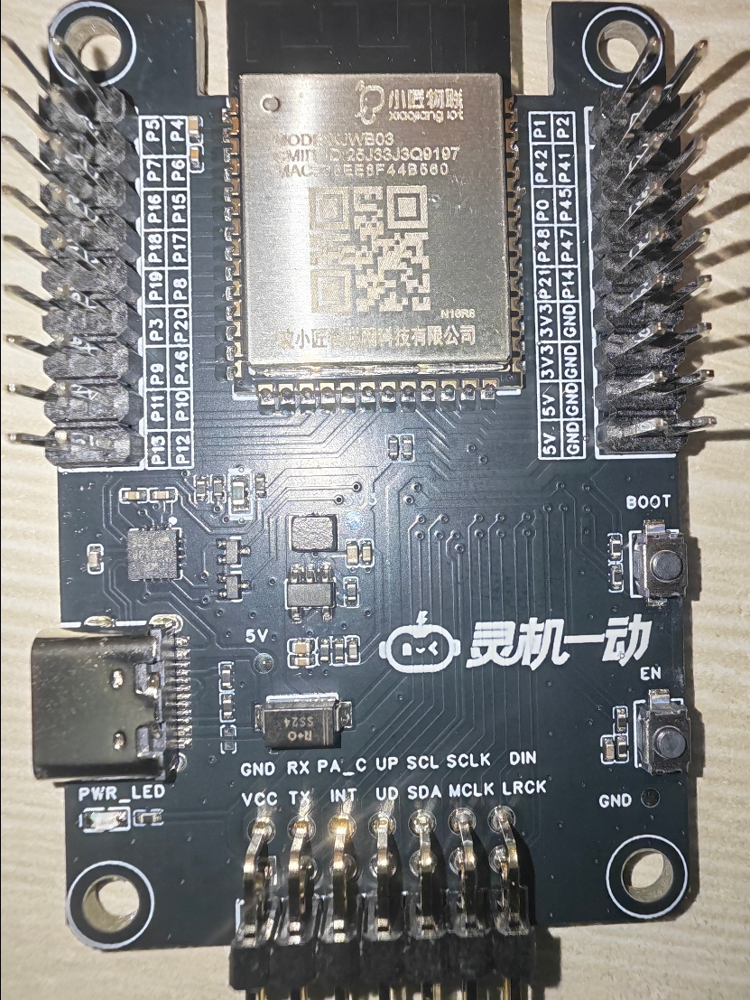
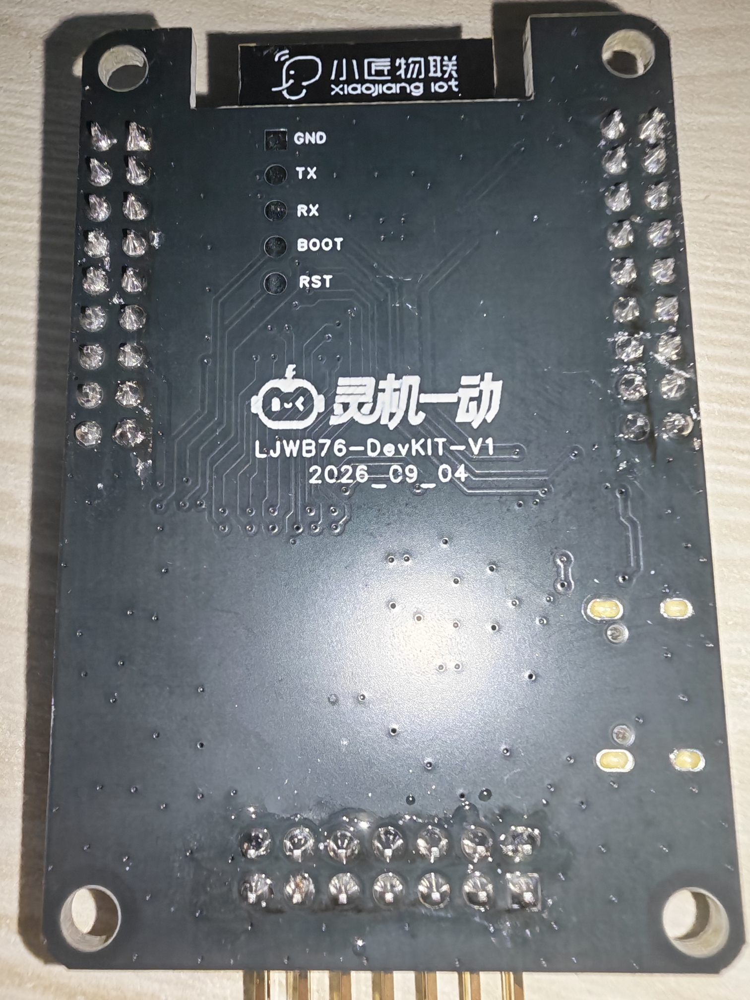

# 灵机 XJWB03 / LJWB76 硬件开发说明书

这套文档帮助初学者从识别板卡、读懂供电和信号、接入传感器与执行器，逐步完成自己的硬件作品。它把 SDK 的软件引脚配置、模块原理图、器件规格书和实物照片分开引用，不把软件配置误写成主板电气原理图。

## 先确认板卡身份

SDK README 和《灵机 XJWB03 标准开发板使用文档》称主控底板为 `XJWB03-DevKIT-V1`；本地实物照片背面与飞书配件图标注为 `LJWB76-DevKIT-V1`。SDK/手册称音频板为 `LJX40-Audio-KIT-V1`，飞书配件图中的音频板照片标注为 `LJX40-Audio-Core-V1`。目前没有主板原理图、BOM 或版本映射证明这些名称是同板别名。使用 GPIO 表或接线前，先核对手上实物丝印和板卡修订号。

## 阅读顺序

1. [项目结构与板卡身份](01_项目结构与身份.md)：仓库各层职责、当前配置和资料冲突。
2. [硬件原理入门](02_硬件原理入门.md)：电压、电流、逻辑电平、I2C、UART、PWM、LED 串行数据。
3. [模块原理与信号链路](03_模块原理与信号链路.md)：MPU6050、相机、舵机、振动模块、WS2812 和音频板。
4. [从零到作品的开发路线](04_从零到作品的开发路线.md)：由单模块验证到多外设集成。
5. [坑点与排障](05_坑点与排障.md)：高风险误接、版本差异和软件配置漂移。
6. [证据与待确认项](06_证据与待确认项.md)：每条结论的来源、可信边界和下一步核对方式。
7. [现场离线编译准备](07_现场离线编译准备.md)：已检出的依赖、IDF 工具版本和本机可复现的构建命令。
8. [使用 EasyInput Flasher 烧录本地 ESP32-S3 包](08_本地固件烧录.md)：固件包位置、导入步骤、地址清单和实物板卡核对要求。

## 证据标签

- `器件/原理图已确认`：来自所给器件数据手册或具体模块原理图。
- `固件声明`：来自检出提交中的宏、BSP 或配置文件，只代表该固件版本的选择。
- `资料声称`：来自手册、供应方说明或商品资料，尚未由当前批次实测复核。
- `待确认`：缺原理图、BOM、修订映射或实板测量，不能当作事实使用。

## 当前分析基线

- 远端仓库：`https://gitee.com/xj-open/ljyd_xjwb03_agent_public_developer`
- 检出分支：`master`，提交 `89020f5e04bf777ae1672b8f3d320bc6e0ef3e0c`，日期 `2026-10-23`。
- 当前工作树通过 `blob:none` partial clone 获取；已检出应用、`components/`、`apps/managed_components/`、ESP-IDF、QUMIOS、tools、补丁和模型所需源码。
- 已安装 IDF 5.4.1 的 ESP32-S3 工具与 Python 3.12.7 环境，`apps` 构建成功；进程级 HTTP/HTTPS 代理阻断后，组件 registry 不可达时仍能 reconfigure/build。没有烧录或实板测试；完整 Git 历史与无关根目录文件未全部下载。
- 仓库没有主控底板的完整原理图、BOM、Gerber 或装配版本说明；主板 GPIO 表来自固件和上手手册，而不是主板电路证据。

## 重要安全边界

- 先确认具体板卡和版本，再使用 GPIO；`GPIO4`、`GPIO8` 在当前固件设计里有外设复用冲突。
- 不从 GPIO 给舵机或马达供电；控制信号和负载电源是两条不同路径。
- WS2812 在 5 V 供电时，数据手册给出的输入高电平门限是 `0.7 × VDD`；3.3 V GPIO 在 5 V 条件下没有规格保证。
- 公共仓库 README 中存在明文云端密钥风险；本资料不复制该值，维护者应核验并轮换。

## 现场构建准备状态

当前本机 `C:\\Espressif` 仍是 IDF 5.5.5，未改动。项目专用 IDF 5.4.1 工具装在 `%USERPROFILE%\\.espressif`，环境名为 `idf5.4_py3.12_env`。本机验证成功的入口是 PowerShell 中对仓库内 `esp-idf\\export.ps1` 做 export，再在 `apps` 目录运行 `idf.py build`；详见 [现场离线编译准备](07_现场离线编译准备.md)。

注意：仓库 `dev.bat` 当前写死 `idf5.4_py3.14_env`，与本机实际 Python 3.12 环境不一致；本轮未修改它，现场先用已验证的 PowerShell export 路径。生成的 `apps/dependencies.lock` 被 Git 忽略并保留在当前工作区，移动仓库时需留意锁文件中的本机路径。

